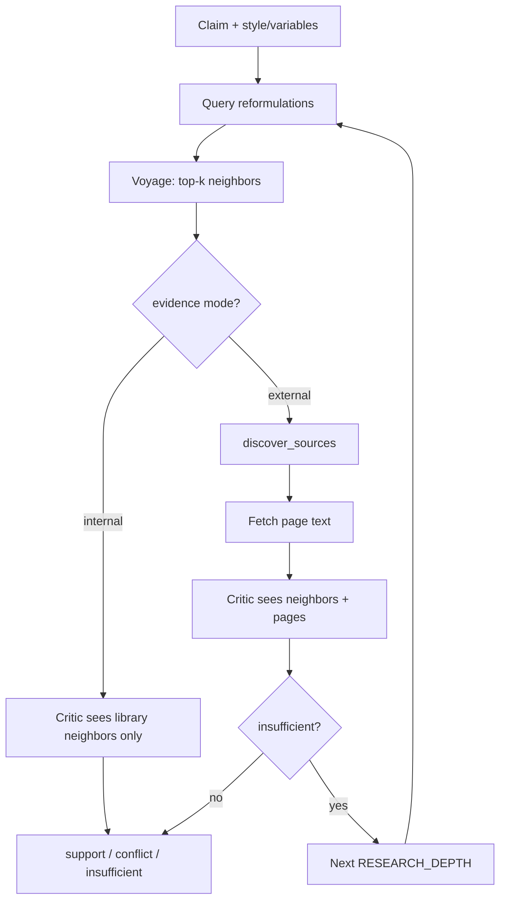

# Claim verification search loop

Reference for how **one claim** is checked against **internal** (library) and **external** (web) sources. This is the verification path, not the expand/seed research pipeline.

Primary code: `passive-research.research_claim` → `research_sources.discover_sources` → `validate.gather_evidence` → `validate.evaluate_truth` → chat critic.

Standalone entry (no library write):

```bash
python synthesis.py validate --claim "..." --bot local --evidence internal
python synthesis.py validate --claim "..." --bot local --evidence external
```

Controller entry (may write if you accept ops):

```bash
python passive-research.py modify --id <card-id> --evidence internal
python passive-research.py modify --id <card-id> --evidence external
python passive-research.py --id <card-id> --no-propagate --evidence external
```

---

## Example claim

Use this sentence as the walkthrough subject:

> **A Sicilian pan dough baked in a steel pan needs a lower oven temperature and a longer bake than a Neapolitan pie to set the crumb without burning the top.**

Card fields that feed query reformulation:

| Field | Example |
| :--- | :--- |
| `id` | `a-sicilian-pan-dough-baked-in-a-steel` |
| `style_scope` | `["sicilian"]` |
| `variables` | `["bake_temp", "bake_time"]` |
| `phase` | `["baking"]` |

---

## Shared first step: library retrieval (always)

Both modes start the same way.

1. Build search strings from the card (`_search_queries`):
   - the claim itself
   - `claim + style + variables + "pizza dough"`
   - style-focused variants (e.g. `sicilian pizza dough bake_temp bake_time …`)
2. Embed the active query with Voyage (`embed_pipeline.query`, `top_k=5`).
3. Collect **library neighbors**: id, claim, confidence, source, similarity.

Those neighbors are the **internal** evidence pack. Everything after this fork depends on `--evidence`.



---

## Path A — Internal verification

**Question answered:** Does *our library* already support, contradict, or leave this claim thin?

**Flag:** `--evidence internal` (or `--no-web`)

### What happens

1. Voyage neighbors are loaded (above).
2. `discover_sources(..., use_web=False)` may still *list* URLs printed on neighbor `source.reference` fields for ranking metadata, but **`gather_evidence` does not HTTP-fetch any pages** in internal mode.
3. The critic prompt receives:
   - `library_neighbors`: the retrieved cards
   - `source_pages`: **empty**
   - `evidence_mode`: `internal`
4. No DuckDuckGo. No page scrape. No depth escalation that depends on new web URLs (escalation still can re-query Voyage with alternate query text in the controller loop, but still without web).

### What “support” means here

- A neighbor (or set of neighbors) states the **same mechanism** with enough specificity, or clearly **contradicts** it.
- A similar card is **not** automatic support in the critic’s instructions — but with no pages, the critic can only lean on library wording and citations already stored on those cards.

### Typical outcomes for the Sicilian example

| Likely neighbors | Internal result |
| :--- | :--- |
| Windowpane / fermentation cards | **insufficient** — on-topic dough science, wrong variable (not bake_temp/time for Sicilian vs Neapolitan) |
| A future card that explicitly compares pan vs pie bake profiles | **support** or **conflict** |

### Run it

```bash
python synthesis.py validate \
  --claim "A Sicilian pan dough baked in a steel pan needs a lower oven temperature and a longer bake than a Neapolitan pie to set the crumb without burning the top." \
  --bot local --evidence internal
```

Inspect the JSON: `evidence_mode`, `verdict`, `rationale`, empty or missing page lists, and any `found` / `not_found` / `open_doubts` the critic returns.

---

## Path B — External verification

**Question answered:** Do *independent sources* (plus the library) support or contradict the claim?

**Flag:** `--evidence external` (default)

### What happens

1. Same Voyage neighbor step.
2. `discover_sources` builds a ranked URL list:
   1. **library** — `http(s)` refs on neighbor cards (ranked by similarity)
   2. **extra** — operator-provided URLs (if any)
   3. **search** — DuckDuckGo HTML results for the claim and reformulations (`… pizza dough`, style bake queries, etc.)
3. URLs are deduped and capped (`max_candidates` grows with depth).
4. `gather_evidence` **fetches** up to `max_pages` of those URLs and truncates each body for the critic.
5. The critic sees:
   - `library_neighbors`
   - `source_pages`: `{url, text, error}`
   - search errors if DDG/fetch failed
6. Verdict `support` / `conflict` / `insufficient`, plus citations, `found`, `not_found`, `open_doubts`.

### Depth escalation (controller `research_claim`)

If the verdict stays **insufficient**, the controller escalates through `RESEARCH_DEPTHS`:

| Depth | max_pages | max_candidates | search_limit |
| :---: | :---: | :---: | :---: |
| 1 | 3 | 8 | 4 |
| 2 | 5 | 12 | 6 |
| 3 | 8 | 16 | 8 |

Each depth may switch to a stronger reformulated query and merge `found` / `not_found` / `open_doubts` / `urls_considered` across attempts. Stops early on **support** or **conflict**. After depth 3 still thin → claim stays unresolved for the session (recorded attempt, not deleted).

Standalone `synthesis.py validate` runs a **single** evidence gather (no multi-depth loop) unless you call the controller path.

### What “support” means here

- At least one fetched page (or a library card that itself carries an independent citation) backs the **mechanism** (lower temp + longer bake for Sicilian steel pan vs Neapolitan).
- Library similarity alone is not enough; the critic is told a lookalike card is not support without a real source.

### Typical outcomes for the Sicilian example

| Sources found | External result |
| :--- | :--- |
| Only windowpane / gluten articles | **insufficient** — `not_found` lists bake-temp comparison; `open_doubts` stay open |
| Serious pizza / bakery pages on pan pizza bake profiles | **support** (or **conflict** if they recommend the opposite) |

### Run it

```bash
python synthesis.py validate \
  --claim "A Sicilian pan dough baked in a steel pan needs a lower oven temperature and a longer bake than a Neapolitan pie to set the crumb without burning the top." \
  --bot local --evidence external

# Same claim as a library card, with depth escalation
python passive-research.py modify --id a-sicilian-pan-dough-baked-in-a-steel --evidence external
```

---

## Side-by-side

| Step | Internal | External |
| :--- | :--- | :--- |
| Voyage neighbors | yes | yes |
| DuckDuckGo | no | yes |
| Fetch page HTML | no | yes (capped) |
| Critic input | library JSON only | library + `source_pages` |
| Depth escalation | query reformulation only (controller) | queries + larger page/search budgets |
| Good for | library consistency, echo-chamber check | grounding a claim in the open web |
| Bad for | proving new bake physics | trusting a thin library alone |

---

## After the verdict (controller only)

Verification stops at the critic unless you are in `passive-research` and accept ops:

| Verdict | Typical ops |
| :--- | :--- |
| **support** | `validate` (raise confidence, `reviewed`) and maybe `add` / `propagate` if not `--no-propagate` |
| **conflict** | `modify` (narrow) or `remove` / demote |
| **insufficient** | no library edit; record attempt + doubts |

Expand/seed phases are **not** part of this document — see [`passive-research.md`](passive-research.md).

---

## Full source list

Every verify pass attaches `sources`: the complete inventory for that loop (merged across depths in the controller).

| Field | Meaning |
| :--- | :--- |
| `kind` | `library` \| `search` \| `extra` \| `citation` |
| `id` | Library neighbor id (library rows) |
| `url` | http(s) reference when present |
| `discovered_via` | How it entered the candidate set |
| `rank` / `similarity` | Ranking signal |
| `reason` | Short provenance note |
| `fetch_status` | `fetched_ok` \| `fetched_failed` \| `not_fetched` \| `skipped_internal` \| `not_applicable` \| `cited_only` |
| `cited` | Critic listed this URL/id in `citations` |

Internal loops list library neighbors (and their refs). External loops add ranked web URLs with fetch outcomes. The session report prints this under **Full source list**.

## `sourcewise_supported` tag

When the verdict is **support** and at least one **cited** entry has an http(s) URL, the card gets:

```json
"tags": ["sourcewise_supported"]
```

Also mirrored on the truth object as `sourcewise_supported: true`.

| Situation | Tag |
| :--- | :--- |
| Support + cited article URL | **yes** `sourcewise_supported` |
| Support with no URL citations (library prose only) | **no** |
| Conflict / insufficient | tag **removed** if present |

This separates “critic said support” from “support is anchored to a real source URL.”

## Reading the output

Useful fields on the truth / corroboration object:

| Field | Meaning |
| :--- | :--- |
| `evidence_mode` | `internal` or `external` |
| `verdict` | `support` \| `conflict` \| `insufficient` \| `skipped` \| `error` |
| `score` | Critic confidence in that verdict (gates policy; not the same as card `confidence`) |
| `rationale` | Short prose |
| `citations` | Title/URL pairs the critic cited |
| `sources` | Full inventory (see above) |
| `sourcewise_supported` | True when support is URL-anchored |
| `found` / `not_found` / `open_doubts` | Structured gaps |
| `pages_checked` / `pages_ok` / `pages_failed` | What was fetched (external) |
| `urls_considered` | Ranked discovery URL strings |
| `queries_used` / `depths_tried` | Escalation trace (controller) |

---

## Related docs

- [`README.md`](README.md) — pipeline overview and command cheat sheet  
- [`passive-research.md`](passive-research.md) — phases, ops, policy caps  
- [`VOYAGE.md`](VOYAGE.md) — what retrieval is (and is not)
