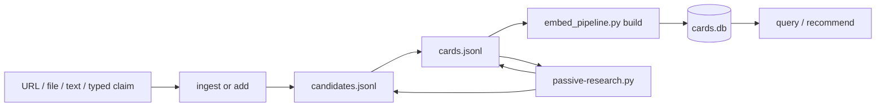

# Dough Research — Insight Cards

Atomic pizza-dough claims in `cards.jsonl`, embedded with Voyage into `cards.db`, verified against web evidence, and expanded by a claims controller.

**Search** finds what the library already knows. **Verification** judges whether a claim is true. Those are different jobs.



---

## Setup

```bash
pip install requests numpy
cp .env.example .env
```

Minimum `.env`:

```env
VOYAGE_API_KEY=...                 # required for build / query / recommend

# Chat (pick at least one path)
LOCAL_LLM_URL=http://127.0.0.1:11434/v1
LOCAL_LLM_MODEL=llama3.1
# or:
# GEMINI_API_KEY=...
# GEMINI_MODEL=gemini-3.5-flash
```

Ollama must be listening on port 11434 if you use the local path (`open -a Ollama`). Voyage still embeds; local/Gemini/Claude only run the chat prompts.

```bash
python embed_pipeline.py build --provider voyage
```

---

## Everyday commands

### Search the library

```bash
python embed_pipeline.py query --provider voyage \
  --text "how do I know if Neapolitan dough is over-proofed"

python embed_pipeline.py query --provider voyage \
  --text "windowpane gluten" --style neapolitan --target fermentation_lab_dashboard
```

### Recommend (coverage + optional drafting)

```bash
python embed_pipeline.py recommend --provider voyage --reasoner local \
  --text "is this Neapolitan dough ready to bake" --threshold 0.7
```

- Score ≥ threshold → synthesized advice from retrieved cards.
- Below threshold → gap drafts in `candidates.jsonl`.
- `--reasoner none` = Voyage score only. `--no-truth` skips the critic. `--no-web` = internal evidence only.

### Verify one sentence (no library write)

Two evidence modes — keep them separate on purpose:

| Mode | Flag | Evidence |
| :--- | :--- | :--- |
| **Internal** | `--evidence internal` (or `--no-web`) | Voyage neighbors only. No DuckDuckGo, no page fetches. |
| **External** | `--evidence external` (default) | Neighbors + ranked web URLs + fetched page text. |

```bash
# Internal: does our library already support / contradict this?
python synthesis.py validate --claim "Cold fermentation increases dough extensibility." \
  --bot local --evidence internal

# External: check independent web sources too
python synthesis.py validate --claim "Cold fermentation increases dough extensibility." \
  --bot local --evidence external
```

Same split on the claims controller:

```bash
python passive-research.py --batch-size 5 --no-propagate --evidence internal
python passive-research.py modify --id cold-ferment-openability --evidence external
```

### Add a claim, then research it

```bash
python passive-research.py add --commit \
  --claim "Raising salt from 2% to 3% of flour weight slows yeast enough to lengthen bulk fermentation before the dough overproofs." \
  --style general --variable salt,fermentation_time,leavening

python passive-research.py --batch-size 5
```

Or continuous: substantiate → expand supported cards → seed coverage gaps:

```bash
python3 -u passive-research.py --until-done --commit --max-actions 40 --delay 8
```

Full claims-controller reference: [`passive-research.md`](passive-research.md).  
How one claim is verified (internal vs external search loop): [`CLAIM_VERIFICATION.md`](CLAIM_VERIFICATION.md).  
Session reports land in `research-reports/` (timestamped + `latest.md`).  
Embedding-only reference: [`VOYAGE.md`](VOYAGE.md).

---

## Which tool when

| You want… | Command |
| :--- | :--- |
| Find related cards | `embed_pipeline.py query` |
| Answer + detect gaps | `embed_pipeline.py recommend` |
| Check a sentence (library only) | `synthesis.py validate --evidence internal` |
| Check a sentence (web too) | `synthesis.py validate --evidence external` |
| Draft cards from a URL/file/paste | `embed_pipeline.py ingest --drafter local` |
| Type one claim into the library | `passive-research.py add` or `embed_pipeline.py add` |
| Re-check / rewrite one card | `passive-research.py modify --id …` |
| Fan a proven claim into workflows | `passive-research.py propagate --id …` |
| Archive a contradicted card | `passive-research.py remove --id …` |
| Overnight research loop | `passive-research.py --until-done --commit` |

After any write to `cards.jsonl` that did not rebuild the index, run `python embed_pipeline.py build --provider voyage`.

---

## Card model

One card = one falsifiable sentence. Contract: [`schema.json`](schema.json).

| Field | Role |
| :--- | :--- |
| `claim` | Embedded text |
| `variables` / `style_scope` / `phase` | What it’s about and when |
| `relevance_targets` | Product surface (`fermentation_lab_dashboard`, `pizza_cart_app`, `mise_en_place`, …) |
| `confidence` | Library weight (new drafts ≤ 0.45) |
| `corroboration` | Critic result: `support` / `conflict` / `insufficient` + `score` + full `sources` list |
| `tags` | Includes `sourcewise_supported` when support is anchored to a cited http(s) URL |
| `refines` / `expands` / `contradicts` | Links to other card ids |

`truth.score` (evidence) and card `confidence` (library) are not the same number. Policy gates use the critic score; drafts are capped separately.

---

## Repository map

| Path | Role |
| :--- | :--- |
| `cards.jsonl` | Source of truth |
| `candidates.jsonl` | Staging for new drafts |
| `archive.jsonl` | Soft-deleted cards (created on first remove) |
| `cards.db` | Voyage vector index |
| `embed_pipeline.py` | `build` / `query` / `ingest` / `add` / `recommend` |
| `passive-research.py` | Claims controller (research / add / modify / remove / propagate) |
| `validate.py` | Truth critic |
| `research_sources.py` | Ranked URL discovery |
| `research_policy.py` | Deterministic lifecycle gates |
| `CLAIM_VERIFICATION.md` | Internal/external verify loop for one claim |
| `synthesis.py` | Gemini / Claude / local chat bots |
| `ingest.py` | Scrape + normalize cards |
| `recommend.py` | Coverage scoring + recommend loop |

---

## Constraints worth knowing

- New learning cards stay **drafts at confidence ≤ 0.45** until you promote them.
- **No hard deletes** — remove archives to `archive.jsonl`. Non-interactive research demotes conflicts instead of archiving.
- Dedup: same normalized sentence, or Voyage similarity ≥ **0.82**.
- Create needs critic support ≥ **0.60**; propagate ≥ **0.55**; archive conflict ≥ **0.35**.
- Cloud chat falls back to local when `LOCAL_LLM_*` is set and Gemini/Claude hits quota or an outage.
- Prefer `python3 -u` when piping research into `tee` so progress lines flush.
