# Dough Research — Insight Card Pipeline

A modular retrieval-and-verification system for pizza dough research. It captures knowledge as atomic, schema-validated "insight cards," embeds them into a local SQLite vector store using Voyage AI, and uses Gemini Flash (or Claude) for automated source ingestion, claim verification, and recommendation synthesis.

```mermaid
flowchart LR
    Source["Source Text / URL / File"] --> Ingest["ingest.py\n(Scrape & Draft)"]
    Ingest --> Candidates["candidates.jsonl\n(Review)"]
    Candidates -- Commit --> Cards["cards.jsonl\n(Source of Truth)"]
    Cards --> Build["embed_pipeline.py build\n(Voyage Embeddings)"]
    Build --> DB[("cards.db\n(Vector Index)")]
    DB --> Query["Semantic Retrieval\n(embed_pipeline.py query)"]
    Query --> Reason["recommend.py + validate.py\n(Truth Check & Synthesis)"]
    Reason --> Output["Recommendation /\nDiagnostic Gaps"]
```



---

## Quick Start

### 1. Install Dependencies

Requires Python 3.9+:

```bash
pip install requests numpy
```

### 2. Configure API Keys

Copy the example environment file and add your keys:

```bash
cp .env.example .env
```

Edit [`.env`](file:///Users/brandonbell/Desktop/RAG/.env):

```env
# Voyage (voyage-4 embeddings): https://dash.voyageai.com
VOYAGE_API_KEY=your_voyage_key_here

# Gemini (drafting & truth checks): https://aistudio.google.com/apikey
GEMINI_API_KEY=your_gemini_key_here

# Recommended for free-tier stability (bypasses gemini-3.8-flash traffic spikes):
GEMINI_MODEL=gemini-3.5-flash

# Optional: only if using --reasoner claude or --drafter claude
# ANTHROPIC_API_KEY=your_anthropic_key_here
```

### 3. Build & Query the Index

```bash
# Embed existing cards from cards.jsonl into cards.db
python embed_pipeline.py build --provider voyage

# Semantic query for relevant cards
python embed_pipeline.py query --provider voyage --text "how do I know if Neapolitan dough is over-proofed"

# Run full recommendation with truth validation
python embed_pipeline.py recommend --provider voyage --reasoner gemini \
  --text "is this Neapolitan dough ready to bake" --threshold 0.7
```

---

## Core Workflows

### 1. Ingesting External Sources into Cards

Scrape an article, text snippet, or local document and use Gemini to draft atomic candidate cards:

```bash
# From a web URL:
python embed_pipeline.py ingest --url "https://www.seriouseats.com/pizza-protips-is-it-ready"

# From a local text/html file:
python embed_pipeline.py ingest --file notes.txt

# From raw text pasted in terminal:
python embed_pipeline.py ingest --text "Cold fermentation for 48 hours improves extensibility..."

# Auto-commit drafts directly to cards.jsonl (bypassing candidates.jsonl):
python embed_pipeline.py ingest --url "https://example.com/dough-tips" --commit
```

> [!NOTE]
> By default, drafted cards are written to `candidates.jsonl` for human review. Once reviewed, commit them with `--commit` or append them to [`cards.jsonl`](file:///Users/brandonbell/Desktop/RAG/cards.jsonl), then re-run `python embed_pipeline.py build --provider voyage`.

### 2. Manually Adding a Claim

Add a single structured card directly to the library:

```bash
python embed_pipeline.py add \
  --claim "For Neapolitan dough, poke-test spring-back beats clock time." \
  --style neapolitan \
  --target fermentation_lab_dashboard \
  --variable tactility
```

### 3. Semantic Retrieval & Filtering

Search cards with optional structured metadata filters:

```bash
python embed_pipeline.py query --provider voyage \
  --text "windowpane gluten development" \
  --style neapolitan \
  --target fermentation_lab_dashboard \
  --top-k 5
```

### 4. Recommendation Loop & Knowledge Gaps

Evaluates whether the current card library has sufficient evidence to answer a question or make a operational recommendation. If evidence is lacking, the reasoner drafts targeted gap-filling cards:

```bash
python embed_pipeline.py recommend --provider voyage --reasoner gemini \
  --text "How can I tell if a Neapolitan dough has over-proofed?" \
  --threshold 0.7 --commit
```

- If `knowledge_score >= threshold`: outputs a synthesized recommendation.
- If `knowledge_score < threshold`: lists identified gaps and drafts candidate cards.

### 5. Standalone Truth Verification

Validate whether a specific claim is supported, contradicted, or insufficiently evidenced by web sources and existing cards:

```bash
python synthesis.py validate --claim "Cold fermentation increases dough extensibility."
```

---

## Data Model & Schema

Each insight card represents **one atomic, falsifiable claim** about dough behavior. The canonical contract is defined in [`schema.json`](file:///Users/brandonbell/Desktop/RAG/schema.json).

| Field | Type | Description | Example |
| :--- | :--- | :--- | :--- |
| `id` | string (slug) | Unique, stable identifier | `windowpane-test-gluten-check` |
| `claim` | string | Single factual assertion | `"Poke-test spring-back indicates dough readiness."` |
| `variables` | string[] | Controlled or observed parameters | `["fermentation_time", "temperature", "tactility"]` |
| `style_scope` | string[] | Applicable dough styles | `["neapolitan", "ny_slice", "general"]` |
| `relevance_targets` | string[] | Workflow surface / application | `["fermentation_lab_dashboard", "pizza_cart_app"]` |
| `phase` | string / string[] | Workflow stage | `bulk_fermentation`, `proofing`, `baking` |
| `confidence` | float (0–1) | Confidence score | `0.75` |
| `source` | object | Attribution metadata | `{"type": "article", "reference": "https://..."}` |
| `corroboration` | object | Truth validation result | `{"verdict": "support", "score": 0.85, ...}` |

---

## Repository Map

| File | Role & Extension Point |
| :--- | :--- |
| [`cards.jsonl`](file:///Users/brandonbell/Desktop/RAG/cards.jsonl) | **Source of truth**: Hand-curated knowledge base of schema-valid cards. |
| [`cards.db`](file:///Users/brandonbell/Desktop/RAG/cards.db) | **Generated index**: Local SQLite database storing Voyage float vector blobs. |
| [`schema.json`](file:///Users/brandonbell/Desktop/RAG/schema.json) | **Contract**: Schema rules, enums, and required fields. |
| [`embed_pipeline.py`](file:///Users/brandonbell/Desktop/RAG/embed_pipeline.py) | **CLI Dispatcher & Vector Store**: CLI entry point for `build`, `query`, `ingest`, `add`, and `recommend`. |
| [`ingest.py`](file:///Users/brandonbell/Desktop/RAG/ingest.py) | **Scraper & Drafter**: Scrapes web/files/text and shapes text into normalized cards. |
| [`recommend.py`](file:///Users/brandonbell/Desktop/RAG/recommend.py) | **Scoring & Loop**: Calculates retrieval scores, detects knowledge gaps, and manages iteration rounds. |
| [`validate.py`](file:///Users/brandonbell/Desktop/RAG/validate.py) | **Truth Critic**: Gathers evidence from nearby cards and DuckDuckGo web search to evaluate claim validity. |
| [`synthesis.py`](file:///Users/brandonbell/Desktop/RAG/synthesis.py) | **Generative LLM Bridge**: Interacts with Gemini (`GeminiBot`) and Anthropic (`ClaudeBot`). Implements retries and JSON parsers. |
| [`VOYAGE.md`](file:///Users/brandonbell/Desktop/RAG/VOYAGE.md) | **Embedding Reference**: Details on `voyage-4` scoring behavior, similarity thresholds, and indexing contracts. |
| [`passive-research.md`](file:///Users/brandonbell/Desktop/RAG/passive-research.md) | **Autonomous Research Guide**: Operating the safe, bounded background research loop with [`passive-research.py`](file:///Users/brandonbell/Desktop/RAG/passive-research.py). |

---

## Operational Details & Resilience

### Gemini Model Selection & Free Tier

- Default model in code: `gemini-3.8-flash`.
- **Recommended in** [`.env`](file:///Users/brandonbell/Desktop/RAG/.env): `GEMINI_MODEL=gemini-3.5-flash`.
- *Why:* Google AI Studio free tier periodically experiences high-demand spikes on `gemini-3.8-flash` (returning `503 UNAVAILABLE` or stalling connections). Setting `gemini-3.5-flash` provides stable, low-latency responses.

### Automatic Retries & Backoff

- Calls to Gemini in [`synthesis.py`](file:///Users/brandonbell/Desktop/RAG/synthesis.py) include automatic exponential backoff retry logic (up to 4 attempts) handling transient `503`, `429` (rate limits), and connection/read timeouts.
- After those retries are exhausted, the same prompt is sent to a local OpenAI-compatible model when `LOCAL_LLM_URL` and `LOCAL_LLM_MODEL` are set (Ollama at `http://127.0.0.1:11434/v1`, or LM Studio at `http://127.0.0.1:1234/v1`). `--bot local`, `--drafter local`, and `--reasoner local` skip the cloud call. This fallback covers the chat prompts only. Voyage embeddings still need `VOYAGE_API_KEY`.

### Offline & Web Modes

- By default, `recommend` and `validate` use DuckDuckGo to search the web for corroborating citations.
- Use `--no-web` to restrict validation to local card library evidence only.
- Use `--no-truth` to skip LLM truth verification and evaluate pure library similarity coverage.

### macOS Python Warning Suppression

- On macOS system Python 3.9, `urllib3 v2` can log `NotOpenSSLWarning` due to Apple's built-in LibreSSL. This warning is filtered out automatically by `embed_pipeline.py` and `synthesis.py`.
