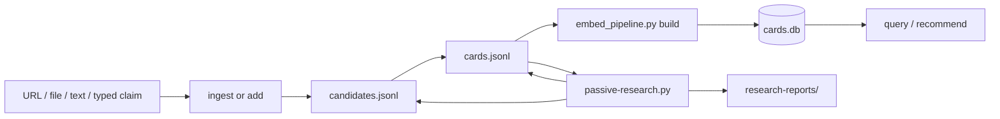

# Dough Research — Insight Cards

Atomic pizza-dough claims in `cards.jsonl`, embedded with Voyage into `cards.db`, verified against evidence, and grown by a claims controller.

**Search** finds what the library already knows. **Verification** judges whether a claim is true. **Growth** mints new drafts only after support (or explicit seed/ingest).

Primary use-case guide (feedback + toggles): [`USE_CASES.md`](USE_CASES.md).



---

## Setup

```bash
pip install requests numpy
cp .env.example .env
```

Minimum `.env`:

```env
VOYAGE_API_KEY=...                 # required for build / query / recommend

# Chat (pick at least one path)
LOCAL_LLM_URL=http://127.0.0.1:11434/v1
LOCAL_LLM_MODEL=llama3.1
# or:
# GEMINI_API_KEY=...
# GEMINI_MODEL=gemini-3.5-flash
```

Ollama must be listening on port 11434 if you use the local path (`open -a Ollama`). Voyage still embeds; local/Gemini/Claude only run the chat prompts.

```bash
python embed_pipeline.py build --provider voyage
```

---

## Use cases (short)

| You want… | Command | What you see afterward |
| :--- | :--- | :--- |
| Find related cards | `embed_pipeline.py query` | Ranked hits (no write) |
| Answer a product question | `embed_pipeline.py recommend … --profile ask` | Advice or gaps; no drafts unless `--draft-gaps` |
| Check one sentence (library) | `synthesis.py validate --evidence internal` | Verdict + library `sources` |
| Check one sentence (web) | `synthesis.py validate --evidence external` | Verdict + full `sources` |
| Verify batch, no new claims | `passive-research.py --profile verify` | Ops + `research-reports/` |
| Verify + fan into workflows | `passive-research.py --until-done --profile grow` | validate + propagate/adds |
| Overnight full growth | `passive-research.py --until-done --profile full --commit` | + seed gaps |
| Type one claim | `passive-research.py add --claim "…"` | Draft staged |
| Import an article | `embed_pipeline.py ingest --url "…"` | Many candidates |
| Fan one supported card | `passive-research.py propagate --id …` | Child drafts |
| Run `/admin` Instance & Log Lab | `python3 admin_server.py --port 8765` | Interactive `/admin` UI + app bridge API |

Modulation (profiles + flags) lives in [`research_features.py`](research_features.py). Details and app hooks: [`USE_CASES.md`](USE_CASES.md).

### Profiles

| Profile | Meaning |
| :--- | :--- |
| `verify` | Substantiate only — no adds, propagate, expand, or seed |
| `grow` | Verify + evidence-tied children — no seed |
| `full` | grow + seed (default) |
| `ask` | Recommend defaults — gap drafts off until `--draft-gaps` |

Overrides: `--no-expand`, `--no-seed`, `--no-propagate`, `--no-evidence-adds`, `--no-focused-propagate`, `--growth-requires-sourcewise`, `--no-draft` / `--draft-gaps`.

### Evidence modes

| Mode | Flag | Critic sees |
| :--- | :--- | :--- |
| **Internal** | `--evidence internal` / `--no-web` | Voyage neighbors only |
| **External** | `--evidence external` (default) | Neighbors + web URLs + page text |

### Everyday examples

```bash
# Search
python embed_pipeline.py query --provider voyage --text "Neapolitan over-proofed"

# Ask (no candidates)
python embed_pipeline.py recommend --provider voyage --reasoner local \
  --text "is this Neapolitan dough ready to bake" --profile ask

# Verify one claim externally
python synthesis.py validate --claim "Cold fermentation increases dough extensibility." \
  --bot local --evidence external

# Verify-only research batch
python passive-research.py --profile verify --evidence external --batch-size 5

# Grow from support (no seeding)
python3 -u passive-research.py --until-done --profile grow --commit --max-actions 40

# Full loop
python3 -u passive-research.py --until-done --profile full --commit --max-actions 40 --delay 8
```

Session reports: `research-reports/YYYY-MM-DDTHHMMSS.md` and `research-reports/latest.md`.

More: [`passive-research.md`](passive-research.md) · [`CLAIM_VERIFICATION.md`](CLAIM_VERIFICATION.md) · [`VOYAGE.md`](VOYAGE.md)

---

## Card model

One card = one falsifiable sentence. Contract: [`schema.json`](schema.json).

| Field | Role |
| :--- | :--- |
| `claim` | Embedded text |
| `variables` / `style_scope` / `phase` | What it’s about and when |
| `relevance_targets` | Product surface (`fermentation_lab_dashboard`, `pizza_cart_app`, `mise_en_place`, …) |
| `confidence` | Library weight (new drafts ≤ 0.45) |
| `corroboration` | Critic result + full `sources` list |
| `tags` | `sourcewise_supported` when support is URL-anchored |
| `refines` / `expands` / `contradicts` | Links to other card ids |

`truth.score` (evidence) ≠ card `confidence` (library). Policy gates use the critic score; drafts are capped separately.

---

## Repository map

| Path | Role |
| :--- | :--- |
| `USE_CASES.md` | Use cases, feedback, modulation |
| `cards.jsonl` | Source of truth |
| `candidates.jsonl` | Staging for new drafts |
| `archive.jsonl` | Soft-deleted cards |
| `cards.db` | Voyage vector index |
| `research-reports/` | Timestamped session reports |
| `research_features.py` | Profiles + feature toggles |
| `embed_pipeline.py` | `build` / `query` / `ingest` / `add` / `recommend` |
| `passive-research.py` | Claims controller |
| `validate.py` | Truth critic + source inventory |
| `research_sources.py` | Ranked URL discovery |
| `research_policy.py` | Lifecycle gates |
| `synthesis.py` | Chat bots |
| `ingest.py` | Scrape + normalize |
| `recommend.py` | Coverage + recommend loop |
| `instance_analytics.py` | Dough instance journeys, phase-wise `%` logs, variable isolation, RAG bridge |
| `admin_server.py` | `/admin` web lab + `/api/bridge/*` cross-project HTTP endpoints |

---

## `/admin` Instance & Log Analytics + Cross-Project Bridge

```bash
python3 admin_server.py --port 8765
# Open http://127.0.0.1:8765/admin
```

Implements **A Pizza Dough Instance Record & Log** and shares the `dough-instance-bridge/v1` wire contract with the sibling fermentation app (`v0-yeast-development-app/lib/admin/instance-analytics.ts` + `lib/admin/rag-bridge.ts`):

- **Phase-Wise `%` Logging & `[object referencing]`**: Mixing (`□`), Resting (`▭`), and Fermentation (`⏢`) completion/hydration/rise `%`, °F, duration, tactile cues, and vessel preview linked to physical ball/batch IDs (`#5678 · Ball D1`).
- **Instance Journey, Variable Scrubber & Storybank**: Multi-trial evolution (`T1 → T2 → T3 → T4`), convergence-to-outcome trajectory, qualitative dough-wise **Storybank**, and live-matched **`cards.jsonl`** mechanisms.
- **BALL Composition, `[Task ORDs]` & Scientific Comparison**: Circular baker's `%` + Gay-Lussac $\text{CO}_2$ stoichiometry hub, ordered protocol checklist, and dynamic **Control vs. Variant** comparison that separates **held constants** from **isolated deltas**, flags confounding, and stages 1-variable empirical claims (`source.type = "experiment"`, `confidence ≤ 0.45`) directly into `candidates.jsonl` for internal/external verification.

---

## Constraints worth knowing

- New learning cards stay **drafts at confidence ≤ 0.45** until you promote them.
- **No hard deletes** — remove archives to `archive.jsonl`. Non-interactive research demotes conflicts instead of archiving.
- Dedup: same normalized sentence, or Voyage similarity ≥ **0.82**.
- Create needs critic support ≥ **0.60**; propagate ≥ **0.55**; archive conflict ≥ **0.35**.
- Cloud chat falls back to local when `LOCAL_LLM_*` is set and Gemini/Claude hits quota or an outage.
- Prefer `python3 -u` when piping research into `tee` so progress lines flush.
