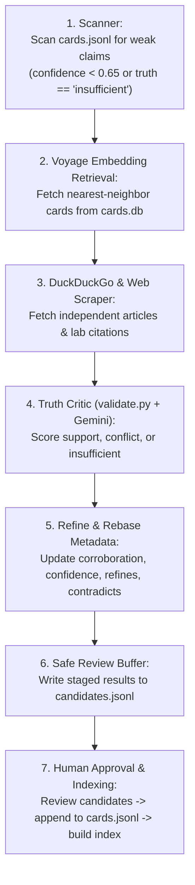

# Autonomous Passive Research Guide

This document describes how to configure and run the **Passive Research State** — an autonomous, bounded background loop that scans low-confidence or unverified claims, searches the web for independent scientific and culinary evidence, evaluates truth, and stages substantiated findings for your review.



---

## 1. Safety Guardrails

Autonomous research in knowledge systems can easily lead to model drift, hallucination compounding, or runaway API usage if unbounded. This pipeline enforces **4 hard safety boundaries**:

| Risk | Architecture Guardrail | Implementation |
| :--- | :--- | :--- |
| **Hallucination Contamination** | **Staging Isolation** | The script reads `cards.jsonl` as immutable reference, writing exclusively to `candidates.jsonl`. Ground truth is never modified autonomously. |
| **Runaway API Costs / Loops** | **Bounded Batching & Rate Limiting** | Max claims per run (e.g. 5 claims), max 2 web pages fetched per claim, and explicit 3–5s delays between queries. |
| **Echo Chambers / Self-Citation** | **Independent Citation Rule** | The critic (`validate.py`) rejects self-referential library claims; it requires external web URLs (`source.reference`) and identifiable mechanisms to assign `support`. |
| **Vector Space Bloat** | **Semantic Deduplication** | Before storing any refined candidate, Voyage embeddings check cosine similarity against existing cards. Cards with similarity $\ge 0.82$ are flagged as duplicates. |

---

## 2. The Script: `passive-research.py`

The script [`passive-research.py`](file:///Users/brandonbell/Desktop/RAG/passive-research.py) coordinates the scan, retrieval, web search, critic evaluation, and staging/committing.

### Operating Modes

#### A. Single-Batch Mode (Default)
Scans up to $N$ weak claims (default 5), attempts web verification, and stages results to [`candidates.jsonl`](file:///Users/brandonbell/Desktop/RAG/candidates.jsonl):
```bash
python passive-research.py --batch-size 5
```

#### B. Continuous "Until-Done" On Mode (`--until-done`)
An autonomous "run until finished" mode that loops iteratively across rounds until one of two exit criteria is met:
1. **Full Verification Success**: **All claims** in [`cards.jsonl`](file:///Users/brandonbell/Desktop/RAG/cards.jsonl) have been evaluated and achieved conclusive support or conflict with confidence $\ge 0.65$.
2. **Exhaustion Halt**: All remaining unverified claims were searched on the web, and **no further corroborating evidence could be found**.

```bash
# Run continuously, auto-committing verified cards and rebuilding cards.db after each round:
python passive-research.py --until-done

# Or run continuously, but stage to candidates.jsonl instead of auto-committing:
python passive-research.py --until-done --no-commit
```

---

## 3. How the "Until-Done" Mode Operates

1. **Active Target Identification**: Scans [`cards.jsonl`](file:///Users/brandonbell/Desktop/RAG/cards.jsonl) for claims where `confidence < 0.65`, `status == "draft"`, or `corroboration.verdict in ("insufficient", None)`.
2. **Dynamic Progress Tracking**:
   - Supported claims: bumps confidence to $\ge 0.75$, marks `status: "reviewed"`, and attaches citation URLs.
   - Conflicted claims: sets confidence to $0.20$ and notes contradicting IDs.
   - Insufficient claims: flagged as *unresolvable for this session* so the loop does not waste API calls querying dead ends repeatedly.
3. **Continuous Re-indexing**: With `--commit` enabled (default in `--until-done`), each newly substantiated batch is immediately written to [`cards.jsonl`](file:///Users/brandonbell/Desktop/RAG/cards.jsonl) and [`cards.db`](file:///Users/brandonbell/Desktop/RAG/cards.db) is rebuilt. This means subsequent unverified claims benefit from the newly proven claims as vector neighbors!
4. **Clean Exit**: The loop terminates gracefully and prints an audit report showing either full library coverage or the exact list of claims that could not be evidenced by web search.

---

## 4. Operational Execution Modes

### Mode A: Scheduled Periodic Background Job (Cron / Automation)
Run the script on a schedule (e.g. nightly at 3:00 AM) so fresh research is ready for review every morning:

```bash
# Add to crontab (crontab -e):
0 3 * * * cd /Users/brandonbell/Desktop/RAG && /usr/bin/python3 passive-research.py >> research.log 2>&1
```

*Or within Antigravity:* You can use the `/schedule` slash command to set a recurring timer to invoke passive research batches.

---

### Mode B: Deep Autonomous Overnight Exploration
If you want the assistant to conduct continuous, multi-source literature reviews overnight (e.g., scraping specific food science sites, testing multiple variables, or exploring specific fermentation regimes):

* Use the `/goal` slash command in chat:
  > `/goal Research all available literature on protease activity in cold-fermented Neapolitan dough. Ingest evidence into candidates.jsonl, substantiate claims with external URLs, and prepare a morning review dossier.`

The agent will run persistently, verifying claims, handling edge cases, and generating a clean summary when finished.

---

## 5. Human Review & Promotion Workflow

When a passive research batch completes, you remain in complete control of what enters your golden knowledge base.

### Step 1: Inspect Staged Candidates
Review the generated findings, citations, and confidence scores:
```bash
cat candidates.jsonl
```

Example candidate record:
```json
{
  "id": "cold-fermentation-protease-extensibility",
  "claim": "Extended cold fermentation at 4C allows protease enzymes to relax gluten bonds, increasing extensibility without causing dough slackness.",
  "variables": ["cold_ferment", "extensibility", "gluten"],
  "style_scope": ["neapolitan", "general"],
  "confidence": 0.8,
  "status": "reviewed",
  "source": {
    "type": "article",
    "reference": "https://www.seriouseats.com/pizza-protips-is-it-ready"
  },
  "corroboration": {
    "verdict": "support",
    "score": 0.85,
    "rationale": "Supported by food science analysis confirming enzymatic gluten relaxation under refrigerated retard.",
    "citations": [
      {"title": "The Pizza Lab: The Science of Long Cold Fermentation", "url": "https://..."}
    ],
    "checked_at": "2026-11-13"
  }
}
```

### Step 2: Commit Approved Cards
Append the approved cards from `candidates.jsonl` into [`cards.jsonl`](file:///Users/brandonbell/Desktop/RAG/cards.jsonl).

### Step 3: Rebuild Vector Index
Re-embed the newly substantiated cards into the local SQLite store:
```bash
python embed_pipeline.py build --provider voyage
```

### Step 4: Verify the New Knowledge Base
Test a query against the newly indexed research:
```bash
python embed_pipeline.py recommend --provider voyage --reasoner gemini \
  --text "How does cold fermentation affect dough extensibility?" \
  --threshold 0.7
```
The system will now pass the `0.70` threshold immediately with strong external corroboration and direct citations.

---

## 6. Configuration & Tuning

You can adjust parameters inside [`passive-research.py`](file:///Users/brandonbell/Desktop/RAG/passive-research.py) to suit your workload:

* **Batch Size (`max_claims`)**: Adjust how many claims are processed in a single run (default `5`). Keep this between 3–10 to respect free-tier rate limits.
* **Confidence Floor (`< 0.65`)**: Raise or lower the bar for which cards qualify as needing research.
* **Rate Limiting (`time.sleep(3)`)**: Adjust delay between DuckDuckGo searches and Gemini API calls to prevent 429/503 rate limit spikes.
