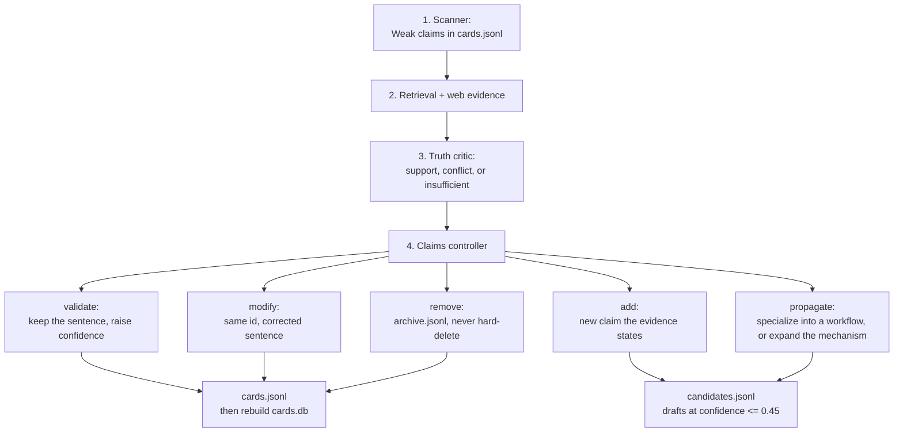

# Autonomous Passive Research Guide

This document describes how to configure and run the **Passive Research State** — an autonomous, bounded background loop that scans low-confidence or unverified claims, searches the web for independent scientific and culinary evidence, evaluates truth, and stages substantiated findings for your review.



---

## 1. Safety Guardrails

Autonomous research in knowledge systems can easily lead to model drift, hallucination compounding, or runaway API usage if unbounded. This pipeline enforces **4 hard safety boundaries**:

| Risk | Architecture Guardrail | Implementation |
| :--- | :--- | :--- |
| **Hallucination Contamination** | **Draft isolation** | `add` and `propagate` write drafts to `candidates.jsonl` with confidence capped at 0.45. They enter `cards.jsonl` only with `--commit` or an interactive yes. `modify` keeps the same card id and stores the previous sentence on `prior_claim`. |
| **Runaway API Costs / Loops** | **Bounded Batching & Rate Limiting** | Max claims per run (e.g. 5 claims), max 2 web pages fetched per claim, and explicit 3–5s delays between queries. |
| **Echo Chambers / Self-Citation** | **Independent Citation Rule** | The critic (`validate.py`) rejects self-referential library claims; it requires external web URLs (`source.reference`) and identifiable mechanisms to assign `support`. |
| **Vector Space Bloat** | **Semantic Deduplication** | Before storing any refined candidate, Voyage embeddings check cosine similarity against existing cards. Cards with similarity $\ge 0.82$ are flagged as duplicates. |

---

## 2. Claims controller

[`passive-research.py`](file:///Users/brandonbell/Desktop/RAG/passive-research.py) is the controller. After the critic returns evidence, it proposes one or more of these operations. A planner model (Gemini, or Claude if that is the configured critic) suggests rewrites and learning cards. If that call fails because of quota or an outage and `LOCAL_LLM_URL` plus `LOCAL_LLM_MODEL` are set, the same prompt goes to that local server. If the local call also fails, the controller follows the critic verdict only and does not invent drafts.

| Operation | When | What changes |
| :--- | :--- | :--- |
| **validate** | Evidence supports the sentence as written | Same id and claim. Confidence rises to at least 0.75. Status becomes `reviewed`. |
| **modify** | Evidence corrects the scope or the mechanism | Same id. New sentence, `prior_claim`, and `revised_at`. A conflict that is only narrowed stays a draft so a later run can re-check it. |
| **remove** | The mechanism is contradicted and a narrower true claim is not available | Card moves to [`archive.jsonl`](file:///Users/brandonbell/Desktop/RAG/archive.jsonl). Without `--interactive`, removal is withheld and the card is demoted instead, so the conflict is recorded and the loop can stop. |
| **add** | Evidence states a different atomic claim | New draft in `candidates.jsonl`. Confidence capped at 0.45. |
| **propagate / specialize** | The same mechanism should be usable in a specific style, phase, or workflow | Child draft with `refines: [parent id]`. Workflow targets are `fermentation_lab_dashboard`, `pizza_cart_app`, and `mise_en_place`. |
| **propagate / expand** | Evidence supports a broader style or an adjacent variable | Child draft with `expands: [parent id]`. |

Specialize drafts that repeat an existing style + phase + workflow for that parent are dropped. So are near-duplicate sentences (normalized text match, or Voyage cosine similarity ≥ 0.82 against a card other than the parent).

### Commands

```bash
# Scan up to 5 weak claims. Confirm nothing. Existing-card edits are written
# to cards.jsonl. New add/propagate drafts stay in candidates.jsonl.
python passive-research.py --batch-size 5

# Same scan, but confirm every operation:
python passive-research.py --interactive --batch-size 5

# Keep going until claims are settled or a round finds no corroborated edits.
python passive-research.py --until-done --max-actions 10

# Research one card, then modify it and fan it out if the evidence supports that.
python passive-research.py modify --id cold-ferment-openability

# Replace one sentence yourself. The id does not change.
python passive-research.py modify --id cold-ferment-openability \
  --claim "Extended cold fermentation relaxes lower-hydration NY dough so it opens with less tearing."

# Add a claim. It is staged at confidence <= 0.45 unless you pass --commit.
python passive-research.py add \
  --claim "Protease activity during cold fermentation increases dough extensibility." \
  --style general --variable fermentation_time,extensibility

# Archive a card.
python passive-research.py remove --id dough-should-feel-springy-not-wet-before-proofig

# Fan one supported claim into workflow-specific and broader learning drafts.
python passive-research.py propagate --id clock-vs-degree-hours

# Research without spawning those drafts.
python passive-research.py --no-propagate
```

`--commit` also inserts the new drafts into `cards.jsonl` and rebuilds `cards.db`. `--max-actions` (default 10) caps how many operations a session applies. Each claim is researched at most once per session.

---

## 3. How "Until-Done" Operates

1. **Active targets**: Claims with confidence below 0.65, status `draft`, or corroboration that is missing, `insufficient`, or `skipped`. A claim already marked `support` or `conflict` with status `reviewed` is left alone.
2. **One pass per claim per session**: Supported claims are validated or rewritten. Contradicted claims are archived only if you confirm; otherwise they are demoted (confidence at most 0.20, status `reviewed`) so the next round does not fetch them again. Insufficient claims are skipped for the rest of the session.
3. **Re-index when the library changes**: Validated and modified cards are written to [`cards.jsonl`](file:///Users/brandonbell/Desktop/RAG/cards.jsonl) and [`cards.db`](file:///Users/brandonbell/Desktop/RAG/cards.db) is rebuilt, so the next round can use them as neighbors. New drafts stay in `candidates.jsonl` unless `--commit` is set.
4. **Stop**: The loop stops when nothing is left to research, a round applies no edits, `--max-actions` is hit, or 20 rounds have run. It prints the ids that stayed unsettled.

---

## 4. Operational Execution Modes

### Mode A: Scheduled Periodic Background Job (Cron / Automation)
Run the script on a schedule (e.g. nightly at 3:00 AM) so fresh research is ready for review every morning:

```bash
# Add to crontab (crontab -e):
0 3 * * * cd /Users/brandonbell/Desktop/RAG && /usr/bin/python3 passive-research.py >> research.log 2>&1
```

*Or within Antigravity:* You can use the `/schedule` slash command to set a recurring timer to invoke passive research batches.

---

### Mode B: Deep Autonomous Overnight Exploration
If you want the assistant to conduct continuous, multi-source literature reviews overnight (e.g., scraping specific food science sites, testing multiple variables, or exploring specific fermentation regimes):

* Use the `/goal` slash command in chat:
  > `/goal Research all available literature on protease activity in cold-fermented Neapolitan dough. Ingest evidence into candidates.jsonl, substantiate claims with external URLs, and prepare a morning review dossier.`

The agent will run persistently, verifying claims, handling edge cases, and generating a clean summary when finished.

---

## 5. Human Review & Promotion Workflow

When a passive research batch completes, you remain in complete control of what enters your golden knowledge base.

### Step 1: Inspect Staged Candidates
Review the generated findings, citations, and confidence scores:
```bash
cat candidates.jsonl
```

Example candidate record:
```json
{
  "id": "cold-fermentation-protease-extensibility",
  "claim": "Extended cold fermentation at 4C allows protease enzymes to relax gluten bonds, increasing extensibility without causing dough slackness.",
  "variables": ["cold_ferment", "extensibility", "gluten"],
  "style_scope": ["neapolitan", "general"],
  "confidence": 0.8,
  "status": "reviewed",
  "source": {
    "type": "article",
    "reference": "https://www.seriouseats.com/pizza-protips-is-it-ready"
  },
  "corroboration": {
    "verdict": "support",
    "score": 0.85,
    "rationale": "Supported by food science analysis confirming enzymatic gluten relaxation under refrigerated retard.",
    "citations": [
      {"title": "The Pizza Lab: The Science of Long Cold Fermentation", "url": "https://..."}
    ],
    "checked_at": "2026-11-13"
  }
}
```

### Step 2: Commit Approved Cards
Append the approved cards from `candidates.jsonl` into [`cards.jsonl`](file:///Users/brandonbell/Desktop/RAG/cards.jsonl).

### Step 3: Rebuild Vector Index
Re-embed the newly substantiated cards into the local SQLite store:
```bash
python embed_pipeline.py build --provider voyage
```

### Step 4: Verify the New Knowledge Base
Test a query against the newly indexed research:
```bash
python embed_pipeline.py recommend --provider voyage --reasoner gemini \
  --text "How does cold fermentation affect dough extensibility?" \
  --threshold 0.7
```
The system will now pass the `0.70` threshold immediately with strong external corroboration and direct citations.

---

## 6. Configuration & Tuning

Flags on [`passive-research.py`](file:///Users/brandonbell/Desktop/RAG/passive-research.py):

* **`--batch-size`**: Weak claims researched per round (default `5`). Keep this between 3 and 10 on the free tier.
* **`--max-actions`**: Applied operations per session (default `10`), counting each validate, modify, add, remove, and propagate.
* **`--confidence-bar`**: Claims at or above this, already reviewed as support or conflict, are skipped (default `0.65`).
* **`--delay`**: Seconds between web lookups (default `3`).
* **`--no-propagate`**: Research and modify claims without spawning workflow drafts.
