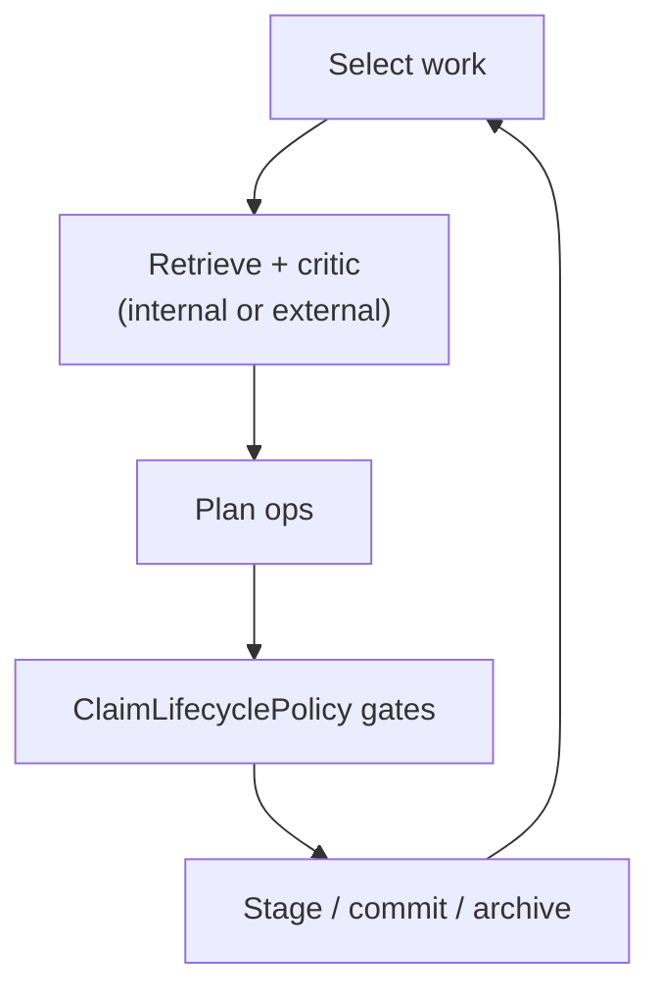

# Claims controller

`passive-research.py` turns evidence into library edits. It does not replace `query` / `recommend` — those search. This tool **verifies and grows** claims.



## Phases

| Phase | What it picks | When |
| :--- | :--- | :--- |
| **substantiate** | Draft / low-confidence / unverified cards | Always (default one-shot) |
| **expand** | Supported reviewed cards with fewer than 3 children | `--until-done` or `--explore` |
| **seed** | Gap drafts for missing preferred styles/variables | After expand queue is empty, same flags |

Default run = substantiate only. Continuous exploration is opt-in.

## Operations

| Op | Meaning |
| :--- | :--- |
| **validate** | Sentence stands. Confidence ≥ 0.75, status `reviewed`. |
| **modify** | Same id, new sentence; old text on `prior_claim`. |
| **remove** | Move to `archive.jsonl`. Non-interactive runs demote instead. |
| **add** | New atomic claim from evidence (or manual `--claim`). |
| **propagate / specialize** | Same mechanism, new style/phase/workflow → child `refines` parent. |
| **propagate / expand** | Broader style or new variable → child `expands` parent. |

Workflow targets for specialize: `fermentation_lab_dashboard`, `pizza_cart_app`, `mise_en_place`.

## Internal vs external verification

Verification ≠ the research pipeline (expand/seed). Within verification, evidence mode is explicit.

Step-by-step walkthrough of the search loop for one claim (with a Sicilian bake example): [`CLAIM_VERIFICATION.md`](CLAIM_VERIFICATION.md).

Each verify pass records a full `sources` inventory on the truth/corroboration object (library neighbors + discovered URLs + fetch/cite status). Claims that are **support** with at least one cited http(s) URL get the card tag `sourcewise_supported`.

Quick reference:

| Mode | Flag | What the critic sees |
| :--- | :--- | :--- |
| **Internal** | `--evidence internal` or `--no-web` | Voyage library neighbors only (claim text, confidence, source refs). **No** web search, **no** HTTP page fetches. |
| **External** | `--evidence external` (default) | Neighbors + ranked URLs (`research_sources`) + fetched page text. |

Use **internal** for “does our library already cover or contradict this?”  
Use **external** for “do independent sources support it?”

```bash
# Library-only check (no write)
python synthesis.py validate --claim "..." --bot local --evidence internal

# Independent web check (no write)
python synthesis.py validate --claim "..." --bot local --evidence external

# Controller verify-only (no expand/seed)
python passive-research.py --batch-size 5 --no-propagate --evidence internal
python passive-research.py modify --id cold-ferment-openability --evidence external
```

## Commands

```bash
# One substantiate batch (external evidence by default)
python passive-research.py --batch-size 5

# Confirm each op
python passive-research.py -i --batch-size 5

# Full loop: substantiate → expand → seed
python3 -u passive-research.py --until-done --commit --max-actions 40 --delay 8

# Manual claim (draft ≤ 0.45)
python passive-research.py add --commit \
  --claim "..." --style general --variable salt,fermentation_time

# Re-research or rewrite one card
python passive-research.py modify --id cold-ferment-openability
python passive-research.py modify --id cold-ferment-openability --claim "Corrected sentence."

# Fan a supported card into workflow drafts
python passive-research.py propagate --id clock-vs-degree-hours

# Soft-delete
python passive-research.py remove --id higher-flour-protein-requires-more-kneading-before-a

# No children this run
python passive-research.py --no-propagate
```

`--commit` writes new drafts into `cards.jsonl` and rebuilds `cards.db`. Without it, add/propagate land in `candidates.jsonl`.

## Safety constraints (enforced in code)

From `research_policy.py` / controller constants:

| Rule | Value |
| :--- | :--- |
| Draft confidence cap | ≤ 0.45 |
| Create needs support score | ≥ 0.60 |
| Propagate needs support score | ≥ 0.55 |
| Archive needs conflict score | ≥ 0.35 |
| Semantic dedup | cosine ≥ 0.82 |
| Propagations per parent | ≤ 3 |
| Adds from one plan | ≤ 2 |
| Seed rounds per session | ≤ 3 |
| Default `--max-actions` | 10 |

Also:

- Critic bounds the planner (support cannot become remove; conflict cannot become validate).
- Specialize must change style, phase, or workflow target; expand must broaden style or add a variable.
- Insufficient evidence is never deletion evidence.
- Thin external searches retry with style/variable reformulations.
- If support yields no workflow drafts, a focused propagation planner runs once.
- Chat uses Gemini/Claude when keyed; otherwise local (`LOCAL_LLM_URL` + `LOCAL_LLM_MODEL`).

## Review after a run

Each controller session writes a basis report under `research-reports/`:

- `research-reports/YYYY-MM-DDTHHMMSS.md` — timestamped snapshot for that run  
- `research-reports/latest.md` — same content, always the most recent run  

```bash
cat research-reports/latest.md
ls research-reports/
cat candidates.jsonl
python embed_pipeline.py build --provider voyage
python embed_pipeline.py query --provider voyage --text "your topic"
```

## Flags

| Flag | Effect |
| :--- | :--- |
| `--batch-size` | Cards per round (default 5) |
| `--max-actions` | Ops applied per session (default 10) |
| `--confidence-bar` | Below this → substantiate first (default 0.65) |
| `--delay` | Seconds between lookups (default 3) |
| `--until-done` / `--explore` | Run all three phases |
| `--commit` | Commit new drafts + rebuild index |
| `--interactive` / `-i` | Confirm each op |
| `--no-propagate` | Skip specialize/expand |
| `--evidence internal\|external` | Evidence mode (default external) |
| `--no-web` | Alias for `--evidence internal` |

Offline checks:

```bash
python -m unittest tests.test_research_policy
python research_policy.py
```
