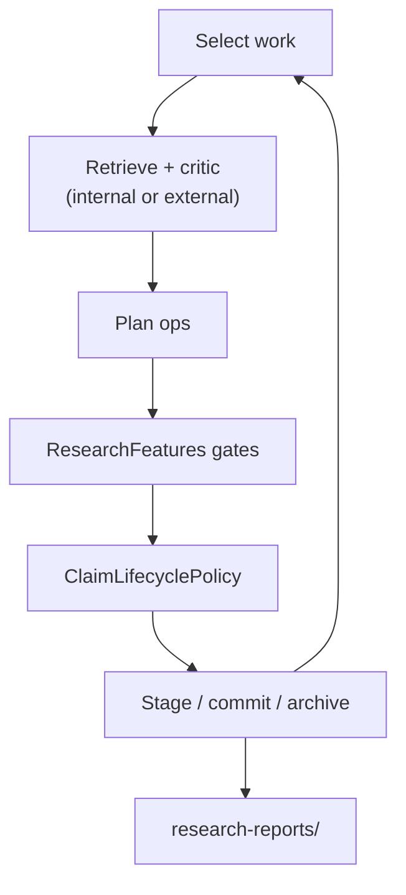

# Claims controller

`passive-research.py` turns evidence into library edits. It does not replace `query` / `recommend` — those search. This tool **verifies and grows** claims.

Use-case matrix (when to run what, feedback, toggles): [`USE_CASES.md`](USE_CASES.md).



## Phases

| Phase | What it picks | When |
| :--- | :--- | :--- |
| **substantiate** | Draft / low-confidence / unverified cards | Default; disable only via custom features |
| **expand** | Supported reviewed cards with fewer than 3 children | `--until-done` / `--explore` and `expand` on |
| **seed** | Gap drafts for missing preferred styles/variables | After expand queue empty; `seed` on |
| **done** | — | expand+seed off or queues empty |

Default one-shot = substantiate only. Continuous exploration is opt-in.

## Operations

| Op | Meaning |
| :--- | :--- |
| **validate** | Sentence stands. Confidence ≥ 0.75, status `reviewed`. |
| **modify** | Same id, new sentence; old text on `prior_claim`. |
| **remove** | Move to `archive.jsonl`. Non-interactive runs demote instead. |
| **add** | New atomic claim from evidence (or manual `--claim`). Gated by `evidence_adds` / seed. |
| **propagate / specialize** | Child `refines` parent (style/phase/workflow). Gated by `propagate`. |
| **propagate / expand** | Child `expands` parent (broader style or new variable). |

Workflow targets for specialize: `fermentation_lab_dashboard`, `pizza_cart_app`, `mise_en_place`.

## Profiles and feature flags

From [`research_features.py`](research_features.py):

| Profile | Behavior |
| :--- | :--- |
| `--profile verify` | Substantiate only — no adds/propagate/expand/seed |
| `--profile grow` | Verify + evidence-tied growth — no seed |
| `--profile full` | grow + seed (default) |

| Flag | Turns off |
| :--- | :--- |
| `--no-expand` | Expand phase |
| `--no-seed` | Coverage seeding |
| `--no-propagate` | specialize/expand children (+ focused pass) |
| `--no-evidence-adds` | Sibling mechanism adds on support |
| `--no-focused-propagate` | Second planner pass when no children returned |
| `--growth-requires-sourcewise` | Growth unless `sourcewise_supported` |

Session log prints `Features: on=[…] off=[…]`. Reports record the same.

## Internal vs external verification

Verification ≠ expand/seed. Evidence mode is separate from growth toggles.

Walkthrough: [`CLAIM_VERIFICATION.md`](CLAIM_VERIFICATION.md).

| Mode | Flag | Critic sees |
| :--- | :--- | :--- |
| **Internal** | `--evidence internal` / `--no-web` | Library neighbors only |
| **External** | `--evidence external` (default) | Neighbors + ranked URLs + pages |

Each pass stores full `sources[]` on corroboration. Support with cited http(s) URLs gets tag `sourcewise_supported`.

```bash
python synthesis.py validate --claim "..." --bot local --evidence internal
python synthesis.py validate --claim "..." --bot local --evidence external

python passive-research.py --profile verify --evidence internal --batch-size 5
python passive-research.py modify --id cold-ferment-openability --evidence external
```

## Commands

```bash
# Verify-only batch
python passive-research.py --profile verify --batch-size 5

# Confirm each op
python passive-research.py -i --profile verify --batch-size 5

# Grow (no seed)
python3 -u passive-research.py --until-done --profile grow --commit --max-actions 40

# Full loop: substantiate → expand → seed
python3 -u passive-research.py --until-done --profile full --commit --max-actions 40 --delay 8

# Manual claim (draft ≤ 0.45)
python passive-research.py add --commit \
  --claim "..." --style general --variable salt,fermentation_time

# Re-research or rewrite one card
python passive-research.py modify --id cold-ferment-openability

# Fan a supported card into workflow drafts
python passive-research.py propagate --id clock-vs-degree-hours

# Soft-delete
python passive-research.py remove --id higher-flour-protein-requires-more-kneading-before-a
```

`--commit` writes new drafts into `cards.jsonl` and rebuilds `cards.db`. Without it, add/propagate land in `candidates.jsonl`.

## Safety constraints

| Rule | Value |
| :--- | :--- |
| Draft confidence cap | ≤ 0.45 |
| Create needs support score | ≥ 0.60 |
| Propagate needs support score | ≥ 0.55 |
| Archive needs conflict score | ≥ 0.35 |
| Semantic dedup | cosine ≥ 0.82 |
| Propagations per parent | ≤ 3 |
| Adds from one plan | ≤ 2 |
| Seed rounds per session | ≤ 3 |
| Default `--max-actions` | 10 |

Also: critic bounds the planner; specialize/expand must change scope; insufficient ≠ delete; thin searches escalate; chat uses Gemini/Claude when keyed else local.

## Review after a run

```bash
cat research-reports/latest.md
ls research-reports/
cat candidates.jsonl
python embed_pipeline.py build --provider voyage
python embed_pipeline.py query --provider voyage --text "your topic"
```

## Flags

| Flag | Effect |
| :--- | :--- |
| `--batch-size` | Cards per round (default 5) |
| `--max-actions` | Ops applied per session (default 10) |
| `--confidence-bar` | Below this → substantiate first (default 0.65) |
| `--delay` | Seconds between lookups (default 3) |
| `--until-done` / `--explore` | Continuous phases |
| `--commit` | Commit new drafts + rebuild index |
| `--interactive` / `-i` | Confirm each op |
| `--profile` | `verify` \| `grow` \| `full` \| `ask` |
| `--no-expand` / `--no-seed` / `--no-propagate` / … | Feature overrides |
| `--evidence internal\|external` | Evidence mode (default external) |
| `--no-web` | Alias for `--evidence internal` |

```bash
python -m unittest tests.test_research_policy tests.test_research_features
python research_policy.py
```
